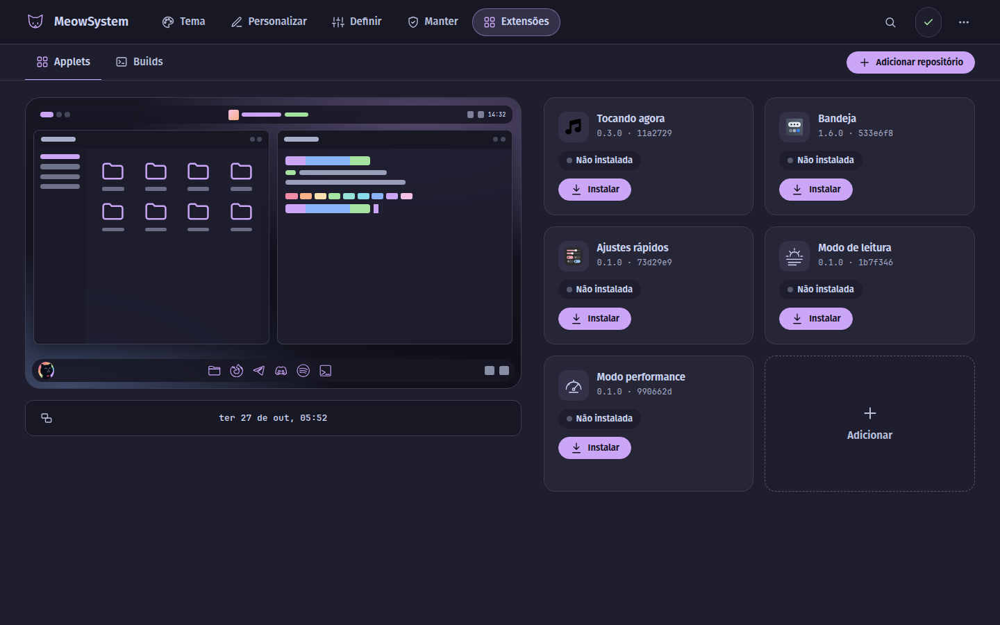
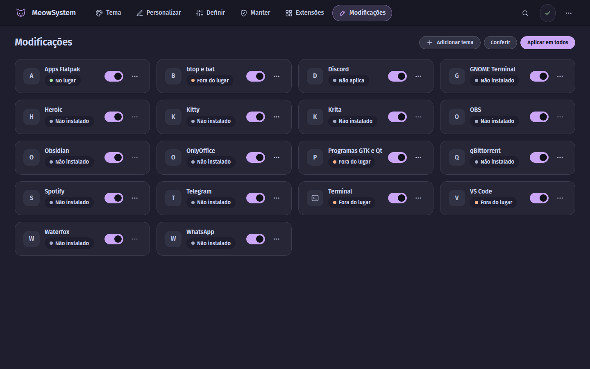

<div align="center">


# MeowSystem

**COSMIC dressed from head to toe by a theme pack, and a doctor that fixes things on its own.**

[](LICENSE)
[](https://github.com/pop-os/cosmic-epoch)

[](install.sh)
[](bin/meow)


[Português](README.md) · [Manual](docs/) · [Credits](docs/CREDITOS.md) · GPL-3.0

</div>

Theme, icons, panel, dock, terminal, login screen, wallpaper and the in-app themes of your programs,
on Pop!_OS with COSMIC, in a single installer, plus a local panel to change all of it without
opening a text file. Everything it writes it knows how to undo, and running it again on a finished
machine writes nothing.

Colors and art come from a **theme pack**: a directory of data, without a single line of code.
What a pack does not declare it inherits, and `meow pack info` tells you where each part came from.

## Install

```bash
git clone https://github.com/vitoriamariadb/MeowSystem.git && cd MeowSystem && ./install.sh
```

Without `git`, from the GitHub archive:

```bash
curl -L https://github.com/vitoriamariadb/MeowSystem/archive/refs/heads/master.tar.gz | tar xz && cd MeowSystem-master && ./install.sh
```

72 steps. None needs a flag. The sudo password is asked **once**, to register the root bridge;
after that, no screen asks for a password. The installer downloads what Pop!_OS does not ship: the
compiler and libraries for the applets, the compositor and the Files menu, Rust (through `rustup`,
in `~/.cargo`), `fastfetch` and `starship`. The compositor builds in the background and takes
effect at the next login. `--wizard` asks the essential settings first; `./install.sh --perfil
<name>` installs with the choices saved in `perfis/<name>/`; `./install.sh --dry-run` rehearses
without writing. From the archive the install is the same, and the installer itself brings the
`git` the applets use to fetch their source.

### From the `.deb` package

No clone needed, with `meowsystem_<version>_all.deb` at hand (`scripts/deb.sh` builds it in `dist/`):

```bash
sudo apt install ./meowsystem_*.deb
meow configurar
```

apt brings the dependencies and puts the program in `/usr/share/meowsystem`, read-only; everything
that belongs to the user stays in their HOME. `meow configurar` asks the essential settings and
installs; `meow aplicar` installs without asking. To remove it:
`/usr/share/meowsystem/install.sh --uninstall`, then `sudo apt remove meowsystem`.

## The panel

`meow abrir`, or the MeowSystem icon in the launcher. 130 settings and 70 actions behind six doors (the panel speaks Portuguese):

<table>
<tr>
<td width="50%"><br><b>Tema</b>: one card per pack: logo, palette, what it brings and what it inherits. Aplicar tema switches packs.</td>
<td width="50%"><br><b>Personalizar</b>: your own pack, step by step: colors, icons, wallpaper, sounds, and download the theme.</td>
</tr>
<tr>
<td width="50%"><br><b>Definir</b>: panel and dock, windows, wallpaper, mascot, day and night and programs.</td>
<td width="50%"><br><b>Manter</b>: the doctor and its fix button, the log, and settings to carry to another machine.</td>
</tr>
<tr>
<td width="50%"><br><b>Extensões</b>: the house applets and your own: install, update, put on the panel, and the compositor builds.</td>
<td width="50%"><br><b>Modificações</b>: one card per program that takes the theme: turn on, turn off, put back in place, and each one's fixes.</td>
</tr>
</table>

## The packs

| pack | flavors | by |
|---|---|---|
| **MeowSystem** (`meowsystem`, the default) | latte, frappe, macchiato, mocha | vitoriamariadb |
| **Dracula** (`dracula`) | dracula, alucard | AndreBFarias |

The format is in [`docs/PACKS.md`](docs/PACKS.md) (Portuguese).

## Keeping it right

`meow doctor` runs 82 checks without writing anything; `meow doctor --consertar` fixes what is out
of place, without asking anyone to type. It runs on its own at 5 a.m., and the **Consertar** button
in the Cuidar door is the same gesture.

When apt brings a new COSMIC, the project's own builds (the compositor with the `patches/` series
and the `cosmic-files` menu) rebuild themselves and take effect on the next login. The whole chain is
in [`docs/MANUTENCAO.md`](docs/MANUTENCAO.md) (Portuguese).

To go back: `meow desfazer` restores the previous theme; `./install.sh --uninstall` removes it all.

## Commands

```bash
meow abrir               # abre o painel de configuração no navegador
meow doctor              # confere tudo em seco. Sai 1 se houver divergência
meow doctor --consertar  # confere e aplica só o que falhou
meow pack                # os theme packs instalados, e se cada um valida
meow pack info <id>      # o que é próprio e o que é herdado no pack
meow desfazer            # volta o tema do COSMIC para antes do MeowSystem
meow log                 # últimas 50 linhas do log
```

## Authors

MeowSystem is by **Vitória Maria** ([vitoriamariadb](https://github.com/vitoriamariadb)), author,
and **André Farias** ([AndreBFarias](https://github.com/AndreBFarias)), co-author. The project's
home is [github.com/vitoriamariadb/MeowSystem](https://github.com/vitoriamariadb/MeowSystem).

Almost everything on screen was drawn by other people:
[Catppuccin](https://github.com/catppuccin/catppuccin), [Dracula](https://draculatheme.com),
[`dracula-icons`](https://github.com/m4thewz/dracula-icons),
[Arcticons](https://github.com/Donnnno/Arcticons) and
[Papirus](https://github.com/PapirusDevelopmentTeam/papirus-icon-theme), among others. The full
list, with licenses, is in [`docs/CREDITOS.md`](docs/CREDITOS.md) and in each pack's `CREDITOS.md`.

## License

GPL-3.0.
