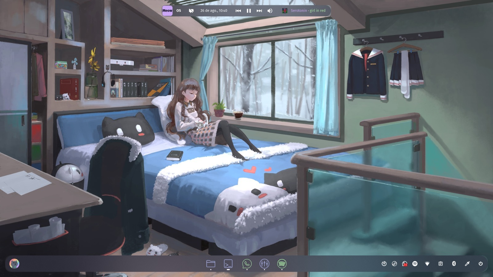
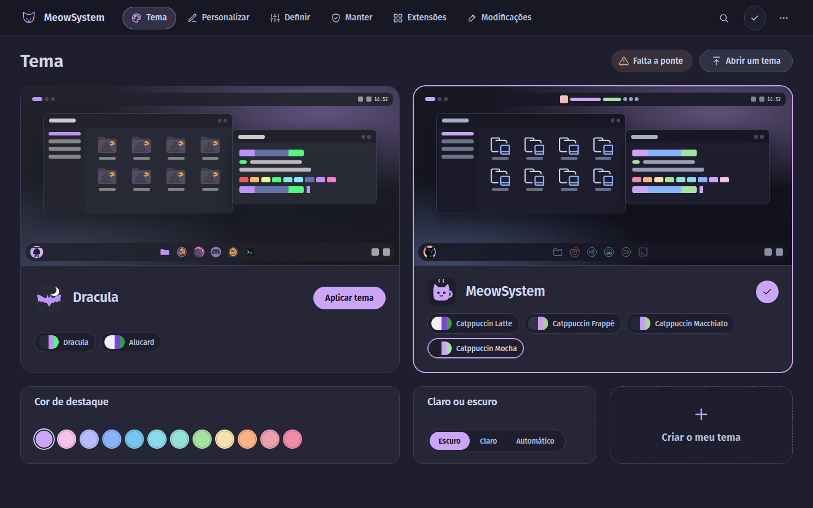
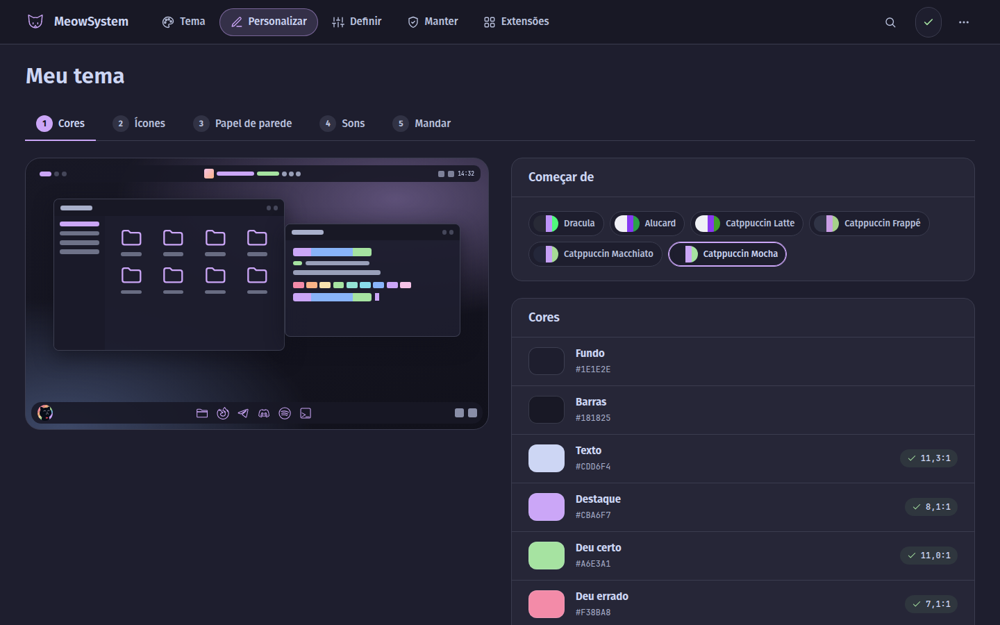
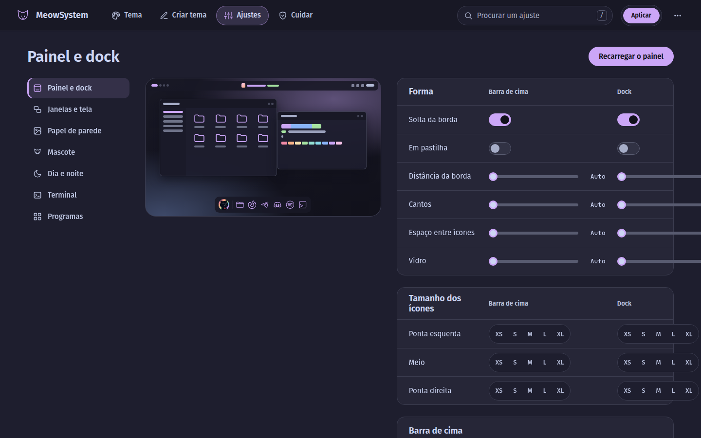
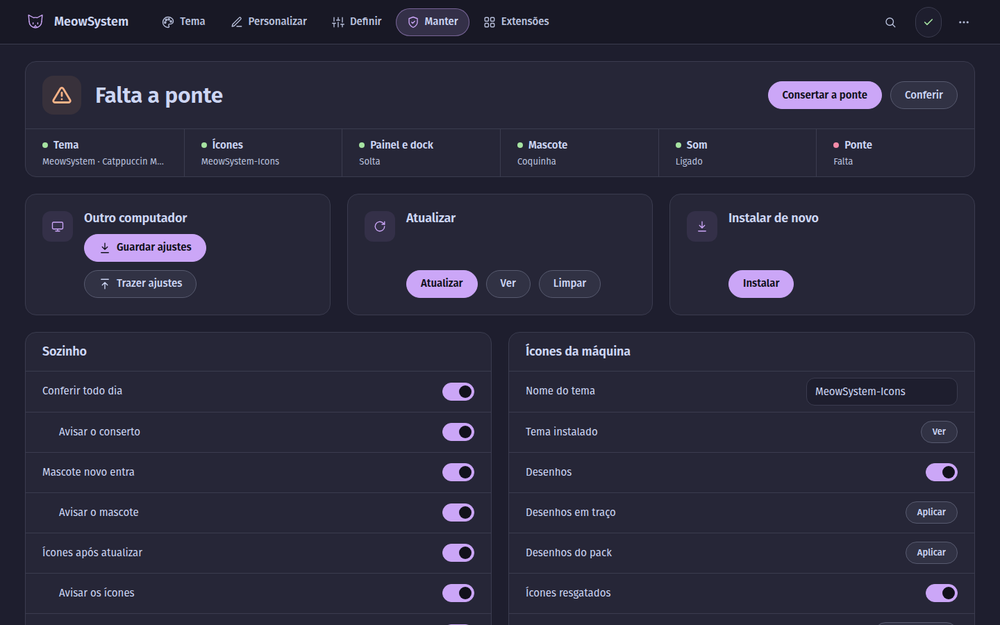

<div align="center">


# MeowSystem

**O COSMIC vestido inteiro a partir de um theme pack, e um doctor que conserta sozinho.**

[](LICENSE)
[](https://github.com/pop-os/cosmic-epoch)

[](install.sh)
[](bin/meow)



[English](README.en.md) · [Manual](docs/) · [Créditos](docs/CREDITOS.md) · GPL-3.0

</div>

Tema, ícones, painel, dock, terminal, tela de login, papel de parede e os temas de dentro dos
programas, no Pop!_OS com COSMIC, num instalador só, e um painel local para mexer em tudo sem abrir
um arquivo de texto. Tudo o que ele escreve, ele sabe desfazer, e rodar de novo numa máquina pronta
não escreve nada.

As cores e a arte vêm de um **theme pack**: um diretório de dados, sem nenhuma linha de código. O
que um pack não declara ele herda, e `meow pack info` diz o que veio de onde.

## Instalar

```bash
git clone https://github.com/AndreBFarias/MeowSystem.git
cd MeowSystem
./install.sh --wizard
```

São 68 etapas. O `--wizard` pergunta as chaves essenciais; `./install.sh --perfil <nome>` instala
com as escolhas guardadas em `perfis/<nome>/`. A senha do sudo é pedida **uma vez**, para registrar
a ponte root; depois, nenhuma tela pede senha. O instalador baixa o que o Pop!_OS não traz: o
compilador e as bibliotecas dos applets, o `fastfetch` e o `starship`. Para ensaiar antes:
`./install.sh --dry-run`.

## O painel

`meow abrir`, ou o ícone MeowSystem no lançador. 122 ajustes e 63 ações em quatro portas:

<table>
<tr>
<td width="50%"><br><b>Tema</b>: um cartão por pack: logo, paleta, o que é próprio e o que herda. Vestir troca o pack.</td>
<td width="50%"><br><b>Criar tema</b>: um pack seu, em passos: cores, ícones, papel de parede, sons, e baixar o tema.</td>
</tr>
<tr>
<td width="50%"><br><b>Ajustes</b>: painel e dock, janelas, papel de parede, mascote, dia e noite, terminal e programas.</td>
<td width="50%"><br><b>Cuidar</b>: o doctor e o Consertar, as pendências, e os ajustes para levar a outra máquina.</td>
</tr>
</table>

## Os packs

| pack | flavors | de | o que é |
|---|---|---|---|
| **MeowSystem** (`meowsystem`, o padrão) | latte, frappe, macchiato, mocha | vitoriamariadb | O pack padrão. Quatro flavors, do Latte ao Mocha. |
| **Dracula** (`dracula`) | dracula, alucard | AndreBFarias | O roxo do Dracula, com os morcegos de mascote. |

O formato está em [`docs/PACKS.md`](docs/PACKS.md).

## Manter

`meow doctor` faz 73 conferências sem escrever nada; `meow doctor --consertar` conserta o que
estiver fora, sem mandar ninguém digitar. Ele roda sozinho às 5h, e o **Consertar** da porta
Cuidar é o mesmo gesto.

Quando o apt traz um COSMIC novo, os builds próprios (o compositor com a série de `patches/` e o
menu do `cosmic-files`) se refazem sozinhos e valem no próximo login. A cadeia inteira está em
[`docs/MANUTENCAO.md`](docs/MANUTENCAO.md).

Para voltar: `meow desfazer` devolve o tema de antes; `./install.sh --uninstall` tira tudo.

## Comandos

```bash
meow abrir               # abre o painel de configuração no navegador
meow doctor              # confere tudo em seco. Sai 1 se houver divergência
meow doctor --consertar  # confere e aplica só o que falhou
meow pack                # os theme packs instalados, e se cada um valida
meow pack info <id>      # o que é próprio e o que é herdado no pack
meow desfazer            # volta o tema do COSMIC para antes do MeowSystem
meow log                 # últimas 50 linhas do log
```

## Autores

O MeowSystem é de **Vitória Maria** ([vitoriamariadb](https://github.com/vitoriamariadb)), autora,
e **André Farias** ([AndreBFarias](https://github.com/AndreBFarias)), coautor. A casa do projeto é
[github.com/vitoriamariadb/MeowSystem](https://github.com/vitoriamariadb/MeowSystem).

Quase tudo o que aparece na tela foi desenhado por outras pessoas:
[Catppuccin](https://github.com/catppuccin/catppuccin), [Dracula](https://draculatheme.com),
[`dracula-icons`](https://github.com/m4thewz/dracula-icons),
[Arcticons](https://github.com/Donnnno/Arcticons) e
[Papirus](https://github.com/PapirusDevelopmentTeam/papirus-icon-theme), entre outros. A lista
inteira, com as licenças, está em [`docs/CREDITOS.md`](docs/CREDITOS.md) e no `CREDITOS.md` de
cada pack.

## Licença

GPL-3.0.
